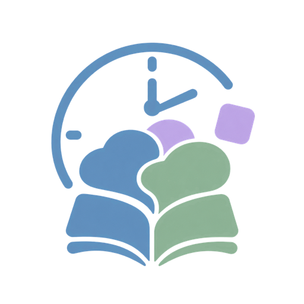

# 项目拆开学 · Learn by Unpacking



> 别再收藏吃灰，把看不懂的材料变成学得会的知识。

[](LICENSE)
[](https://agentskills.io)
[]()

一本书、一篇论文、一份报告、一套课件、一个项目，或任何你想学的主题，都能拆成循序渐进的图解教程、会追问的伴读提示词和可复盘的学习记录。从读懂到讲清，从自测到应用，让每次学习都有路径、有反馈、有积累。

`learn-by-unpacking` 是一个 [Agent Skills](https://agentskills.io) 格式的技能，适合从材料精读入手，也可以围绕一个主题直接展开。

Learn by Unpacking turns any topic or learning material into an illustrated tutorial, a guided study prompt, and a reusable learning journal.

---

## 目录

- [它产出什么](#它产出什么)
- [工作流程](#工作流程)
- [安装](#安装)
- [使用](#使用)
- [仓库结构](#仓库结构)
- [核心约束](#核心约束)
- [目录约定与文件命名](#目录约定与文件命名)
- [校验](#校验)
- [常见问题](#常见问题)
- [贡献](#贡献)
- [许可证](#许可证)

---

## 它产出什么

一次完整的 skill 调用交付三个互相引用的文件：

| 文件 | 角色 | 关键内容 |
|---|---|---|
| `教程-<主题>.md` | 学员读的主干 | 分章图解、练习、总结与可迁移方法。精读时附材料与证据索引 |
| `伴读提示词-<主题>.md` | 交给另一个 AI 的导师脚本 | 角色设定、按天材料清单、可验证学习目标、阶段 A/B/C/D、每日 7 题考察、评分与掌握画像、复习日流程、全程行为准则 |
| `学习记录-<主题>.md` | 学员自己的档案 | 天数概览、每日计划表、压缩笔记、自测成绩表、疑问清单、错题复盘、串联图留白、结课清单 |

三件套的章节数、天数分配、文件名和相对路径必须一致 —— 教程是被读的对象，提示词是带你读的人，记录是你留下来的痕迹。

## 工作流程

<picture>
  <source media="(prefers-color-scheme: dark)" srcset="assets/pipeline-dark.svg">
  
</picture>

1. **确认输入**。明确学习主题、目标、基础、模式、材料范围、每日可用时长与目标天数。
2. **规划章节**。估算各章的阅读、练习与自测时长，再计算推荐天数。

   ```text
   推荐学习天数 = ceil(各章预计学习时长之和 ÷ 每日可用时长)
   ```

   每日时长可建议 30~60 分钟，单章可先按 15~40 分钟估算，再按内容与练习量调整。正文学习后另安排一个复习日。
3. **准备知识或材料**。主题讲解按知识边界组织内容。材料精读逐份读完确认范围，覆盖率达到 100% 后再写正文。两种方式也可结合。
4. **生成三件套**。
5. **交付前自检**。核对章节、日程、图文、引用定位与文件链接。

## 安装

Skill 本体在 [`skills/learn-by-unpacking/`](skills/learn-by-unpacking)。任选一个 agent 的 skills 目录，把整个文件夹放进去即可。

### Claude Code / 通用 `~/.claude/skills`

```bash
git clone https://github.com/Li7777777/learn-by-unpacking.git /tmp/lbu
cp -r /tmp/lbu/skills/learn-by-unpacking ~/.claude/skills/
```

### pi / `.agents/skills`

```bash
git clone https://github.com/Li7777777/learn-by-unpacking.git /tmp/lbu
cp -r /tmp/lbu/skills/learn-by-unpacking ~/.agents/skills/
```

### 作为项目级 skill

在目标仓库里建 `skills/`（或 agent 约定的项目 skills 目录），把 `skills/learn-by-unpacking/` 复制进去，随项目一起提交，团队共享同一份学习协议。

### 只读引用（不复制）

如果你的 agent 支持多 skills 根目录，可以直接把本仓库 clone 到本地，然后把 `skills/` 注册为一个 skills 根：

```bash
git clone https://github.com/Li7777777/learn-by-unpacking.git ~/dev/learn-by-unpacking
# 将 ~/dev/learn-by-unpacking/skills 加入 agent 的 skills 搜索路径
```

安装后确认目录下存在 `SKILL.md` 与 `references/learn-by-unpacking-protocol.md` 两个文件。

## 使用

在 agent 对话里显式点名，或者描述符合触发条件的意图：

```text
用项目拆开学带我入门电影剪辑。每天 40 分钟，先让我能判断一个镜头该在哪里切。
```

```text
用 learn-by-unpacking 精读我上传的行业报告和附表，帮我弄懂核心指标。给我一套教程、伴读提示词和学习记录。
```

常见触发语包括「帮我拆开学」「带我读懂」「逐文件精读」「伴读学习」「教程 + 自测 + 复习」。

**如果 agent 没有自动启用**，直接说明文件名：`请阅读 skills/learn-by-unpacking/SKILL.md 并按其中的协议执行。`

### 一次典型交互

```text
你    → 用项目拆开学精读我上传的报告和附表。
agent → 确认目标、基础、材料范围和日程。
你    → 想弄懂三个关键指标和图表，每天 45 分钟，三天学完，另留一天复习。
agent → 规划 4 章。阅读、练习和自测共约 130 分钟，安排 3 个学习日和 1 个复习日。
你    → 确认。
agent → 读完双方确认的报告页面和表格区域，建立页码及单元格索引，生成三件套。
```

新开对话，复制 `伴读提示词-<主题>.md` 中提示词开始和结束标记之间的内容，并提供教程和所需材料。按日阅读、答题并记录复盘。

## 仓库结构

```text
learn-by-unpacking/
├── README.md
├── LICENSE
├── CHANGELOG.md
├── CONTRIBUTING.md
├── SECURITY.md
├── assets/
│   ├── logo.png                # 项目标志
│   ├── pipeline.svg            # 工作流程图（浅色）
│   └── pipeline-dark.svg       # 工作流程图（深色）
├── scripts/
│   └── validate-skill.mjs      # skill 结构与 frontmatter 校验
├── .github/
│   └── workflows/
│       └── validate.yml        # PR / push 时自动校验
└── skills/
    └── learn-by-unpacking/     # ← skill 本体，复制这一层去安装
        ├── SKILL.md            # 元数据 + 主协议（渐进式披露入口）
        └── references/
            └── learn-by-unpacking-protocol.md   # 详细协议，按需读取
```

`SKILL.md` 包含启用条件与主要流程。`references/` 提供章节骨架、材料精读协议、题库结构与学习记录字段，供生成和审查时参考。

## 核心约束

1. 先确认学习目标、基础、模式、范围与日程，再生成交付文件。
2. 材料精读须读完约定范围再写正文，并记录缺页、无法读取的位置及排除项。
3. 引文和事实应可追溯。按材料选择页码、章节、单元格、时间戳或行号。
4. 每章使用至少四种合适的图文手段，解释概念、用法和依据，并提供练习。
5. 三件套互相引用，章节、学习日与题目分类保持一致。

## 目录约定与文件命名

生成的学习系统建议放在独立目录，便于伴读提示词按相对路径索引：

```text
<学习项目>/
├── 教程-<主题>.md
├── 伴读提示词-<主题>.md
├── 学习记录-<主题>.md
└── assets/                   # SVG 配图，正文引用后紧跟「配图说明」
```

`<主题>` 用简短可辨识的名称，例如 `电影剪辑入门` 或 `行业报告精读`。

## 校验

```bash
node scripts/validate-skill.mjs
```

检查项：`SKILL.md` 存在、frontmatter 含 `name`/`description`、`name` 与目录名一致、description 不超过 1024 字符、`references/` 与 `assets/` 中被链接的文件真实存在。

`.github/workflows/validate.yml` 在每次 push 和 PR 上自动跑同一份脚本。

## 常见问题

**可以用其他语言吗？**
默认用简体中文。需要其他语言时，可以在确认学习目标时指定。

**只有主题、手头没有材料也能用吗？**
可以。选择「主题讲解」模式。材料分析题可以围绕教程中的案例、图表或段落出题。

**7 天的教程一定要 7 天读完吗？**
`推荐天数` 是由章节总时长推出来的建议节奏，可协商；但调整天数应通过增删章节或改变每日时长重新计算，而不是把固定的章节硬摊成另一种分配。

**每日 7 题怎么分配？**
概念理解 2 题、材料分析 2 题、应用迁移 2 题、综合表达 1 题。每题 0~10 分，每日满分 70 分。

**掌握画像怎么读？**
绿色 8~10 分，黄色 5~7 分，红色 0~4 分。反馈会指出需要回看的位置，复习日错题重考每题达到 7 分为当次过关。

## 贡献

新约束、新图文手段、新题型、其他语言的本地化，都欢迎。请先读 [CONTRIBUTING.md](CONTRIBUTING.md)，并保证 `node scripts/validate-skill.mjs` 通过。

发现安全问题时，可以通过 GitHub 私密安全通告报告。见 [SECURITY.md](SECURITY.md)。

## 许可证

[MIT](LICENSE) © 2026 Li7777777

协议文本本身开源；用它生成的教程、笔记和配图归属生成者与使用者，仓库不主张权利。
