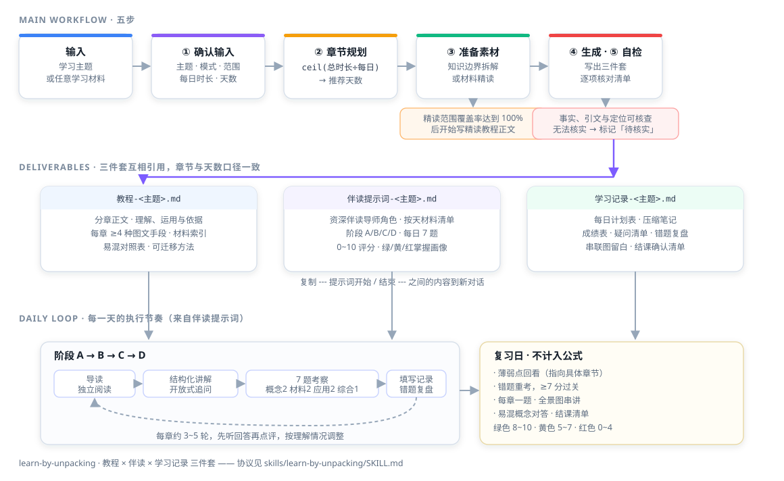

# learn-by-unpacking

> 把一个技术主题或代码库，拆解成一套可长期执行的中文学习系统。

[](LICENSE)
[](https://agentskills.io)
[]()

`learn-by-unpacking` 是一个 [Agent Skills](https://agentskills.io) 格式的 skill。它不回答单个技术问题，而是驱动一次完整的、多天可追踪的学习工程：从**确认输入**到**章节规划**，从**逐行源码精读**到**三件套交付**，最后交给一份伴读提示词带你逐日推进、考察、复盘。

English in one line: an Agent Skill that turns a topic or a source repository into a chaptered, illustrated Chinese tutorial plus a companion-mentor prompt and a study-record template.

---

## 目录

- [它产出什么](#它产出什么)
- [工作流程](#工作流程)
- [安装](#安装)
- [使用](#使用)
- [仓库结构](#仓库结构)
- [核心约束](#核心约束)
- [目录约定与文件命名](#目录约定与文件命名)
- [校验](#校验)
- [常见问题](#常见问题)
- [贡献](#贡献)
- [许可证](#许可证)

---

## 它产出什么

一次完整的 skill 调用交付三个互相引用的文件：

| 文件 | 角色 | 关键内容 |
|---|---|---|
| `教程-<主题>.md` / `README.md` | 学员读的主干 | 分章正文，每章「引子与直觉 → 是什么 → 怎么做 → 为什么这样设计 → 可迁移方法 → 下一站」，含真实源码行号索引 |
| `伴读提示词-<主题>.md` | 交给另一个 AI 的导师脚本 | 角色设定、按天材料清单、可验证学习目标、阶段 A/B/C/D、每日 7 题考察、评分与掌握画像、复习日流程、全程行为准则 |
| `学习记录-<主题>.md` | 学员自己的档案 | 天数概览、每日计划表、压缩笔记、自测成绩表、疑问清单、错题复盘、串联图留白、结课清单 |

三件套的章节数、天数分配、文件名和相对路径必须一致 —— 教程是被读的对象，提示词是带你读的人，记录是你留下来的痕迹。

## 工作流程

<picture>
  <source media="(prefers-color-scheme: dark)" srcset="assets/pipeline-dark.svg">
  
</picture>

1. **先问，再规划** — 在写出任何正文之前，必须确认学习主题、阅读模式、源码范围（如适用）、每日可用时长、目标学习天数。
2. **章节规划决定天数**，而不是反过来：

   ```text
   推荐天数 = ceil(全部章节总阅读时长 ÷ 每日可用时长)
   ```

   默认每日可用时长 150~180 分钟，单章按 2000~7000 字 / 15~40 分钟估算。正文章节完成后额外安排一个不计入公式的全量复习日。
3. **准备知识或源码** — 主题讲解模式拆知识边界；源码精读模式建立覆盖清单，逐文件从头读到尾，不抽样、不跳读，覆盖率 100% 之前禁止写正文。
4. **生成三件套**。
5. **交付前自检** — 逐项核对图文手段数量、章节/天数一致性、行号可追溯性。

## 安装

Skill 本体在 [`skills/learn-by-unpacking/`](skills/learn-by-unpacking)。任选一个 agent 的 skills 目录，把整个文件夹放进去即可。

### Claude Code / 通用 `~/.claude/skills`

```bash
git clone https://github.com/Li7777777/learn-by-unpacking.git /tmp/lbu
cp -r /tmp/lbu/skills/learn-by-unpacking ~/.claude/skills/
```

### pi / `.agents/skills`

```bash
git clone https://github.com/Li7777777/learn-by-unpacking.git /tmp/lbu
cp -r /tmp/lbu/skills/learn-by-unpacking ~/.agents/skills/
```

### 作为项目级 skill

在目标仓库里建 `skills/`（或 agent 约定的项目 skills 目录），把 `skills/learn-by-unpacking/` 复制进去，随项目一起提交，团队共享同一份学习协议。

### 只读引用（不复制）

如果你的 agent 支持多 skills 根目录，可以直接把本仓库 clone 到本地，然后把 `skills/` 注册为一个 skills 根：

```bash
git clone https://github.com/Li7777777/learn-by-unpacking.git ~/dev/learn-by-unpacking
# 将 ~/dev/learn-by-unpacking/skills 加入 agent 的 skills 搜索路径
```

安装后确认目录下存在 `SKILL.md` 与 `references/learn-by-unpacking-protocol.md` 两个文件。

## 使用

在 agent 对话里显式点名，或者描述符合触发条件的意图：

```text
用 learn-by-unpacking 给我做一套 Raft 共识算法的图文并茂教程，我打算 5 天读完。
```

```text
用 learn-by-unpacking 对 ./my-project 做源码精读，我要一套教程 + 伴读提示词 + 学习记录。
```

常见触发语：「反推提示词」「伴读学习」「源码精读」「学习记录」「教程 + 检验 + 复习」「多日技术教程」。

**如果 agent 没有自动启用**，直接说明文件名：`请阅读 skills/learn-by-unpacking/SKILL.md 并按其中的协议执行。`

### 一次典型交互

```text
你   →  用 learn-by-unpacking 精读 ./kvstore
agent →  确认 5 项输入：主题 / 模式 / 范围 / 每日时长 / 天数
        建议排除 3rdparty/、build/、*.lock（生成物与第三方依赖）
你   →  每日 150 分钟
agent →  章节规划：7 章 / 总阅读 940 分钟 → ceil(940/150) = 7 天 + 1 复习日
你   →  可以，开始
agent →  覆盖清单 + 自证：文件总数 X / 已完整读取 X / 覆盖率 100%
agent →  写出三件套 → 交付前自检清单
```

之后你新开一个对话，把 `伴读提示词-<主题>.md` 里 `--- 提示词开始 ---` 到 `--- 提示词结束 ---` 之间的内容整段贴给另一个 AI，它就成了你的伴读导师；你按天读教程、答题、填学习记录。

## 仓库结构

```text
learn-by-unpacking/
├── README.md
├── LICENSE
├── CHANGELOG.md
├── CONTRIBUTING.md
├── SECURITY.md
├── assets/
│   ├── pipeline.svg            # 工作流程图（浅色）
│   └── pipeline-dark.svg       # 工作流程图（深色）
├── scripts/
│   └── validate-skill.mjs      # skill 结构与 frontmatter 校验
├── .github/
│   └── workflows/
│       └── validate.yml        # PR / push 时自动校验
└── skills/
    └── learn-by-unpacking/     # ← skill 本体，复制这一层去安装
        ├── SKILL.md            # 元数据 + 主协议（渐进式披露入口）
        └── references/
            └── learn-by-unpacking-protocol.md   # 详细协议，按需读取
```

`SKILL.md` 只保留决策必需的部分，完整的章节骨架、图文手段清单、源码阅读协议、题库结构和学习记录字段放在 `references/` 里按需加载 —— 这是 Agent Skills 的渐进式披露要求，也是本 skill 自身遵守的「不一次性灌输」原则。

## 核心约束

这几条是 skill 的行为边界，也是它区别于「让 AI 随便写一篇长文」的地方：

1. **未确认输入前不产出文件** — 主题、模式、范围、时长、天数，五项必须先问。
2. **天数由章节总时长推导**，不允许先定天数再硬凑章节。
3. **源码精读模式覆盖率为 100% 才能动笔**，且必须给出自证（文件总数 / 已读数 / 行号索引）。
4. **不编造事实、命令、数字、版本、行号** — 无法核实的内容显式标记「待核实」。
5. **单章至少四种图文手段**（ASCII 图 / SVG 配图 / 对比表 / 代码块 / 引用 / 加粗），且配图必须解释结构或流程，不得只是装饰。
6. **每章回答「是什么、怎么做、为什么」**，并说明设计取舍、易混概念和可迁移方法。
7. **三件套互相引用且口径一致**。

约束 3 和 4 是硬性的：一份把行号写错的源码教程，比没有教程更有害，因为它会被反复引用。

## 目录约定与文件命名

生成的学习系统建议放在独立目录，便于伴读提示词按相对路径索引：

```text
<学习项目>/
├── 教程-<主题>.md            # 或 README.md
├── 伴读提示词-<主题>.md
├── 学习记录-<主题>.md
└── assets/                   # SVG 配图，正文引用后紧跟「配图说明」
```

`<主题>` 用简短可辨识的中文名（如 `Raft共识`、`Mamba架构`）。代码块必须区分**真实源码**与**示意伪代码**，这是源码精读模式的底线。

## 校验

```bash
node scripts/validate-skill.mjs
```

检查项：`SKILL.md` 存在、frontmatter 含 `name`/`description`、`name` 与目录名一致、description 不超过 1024 字符、`references/` 与 `assets/` 中被链接的文件真实存在。

`.github/workflows/validate.yml` 在每次 push 和 PR 上自动跑同一份脚本。

## 常见问题

**为什么默认中文？**
目标场景是中文技术学习与源码精读，导师风格（循循善诱、层层追问、解释取舍）在中文语境下更成套。把 `SKILL.md` 里的语言约定改掉即可用于其他语言。

**只有主题、没有代码库能用吗？**
可以。选择「主题讲解」模式，跳过覆盖清单和行号索引，其余流程不变。

**7 天的教程一定要 7 天读完吗？**
`推荐天数` 是由章节总时长推出来的建议节奏，可协商；但调整天数应通过增删章节或改变每日时长重新计算，而不是把固定的章节硬摊成另一种分配。

**每日 7 题为什么是 2/2/2/1？**
概念 2 题（定义、分类、边界）+ 源码 2 题（机制、参数、条件、行号）+ 设计 2 题（取舍、为什么、对比）+ 综合 1 题（完整链路或代码骨架）。这个配比同时压住「记住了」「读懂了」「想通了」三件事，缺任何一类都会出现会背不会用的情况。

**掌握画像的阈值含义？**
每题 0~10 分。绿色 ≥8 已掌握，黄色 5~7 需回看，红色 ≤3 必须重读对应章节。复习日错题重考以 ≥7 为过关线。

## 贡献

新约束、新图文手段、新题型、其他语言的本地化，都欢迎。请先读 [CONTRIBUTING.md](CONTRIBUTING.md)，并保证 `node scripts/validate-skill.mjs` 通过。

发现可被利用的行为问题（例如诱导编造行号的路径），请按 [SECURITY.md](SECURITY.md) 私下发件人报告，不要开公开 issue。

## 许可证

[MIT](LICENSE) © 2026 Li7777777

协议文本本身开源；用它生成的教程、笔记和配图归属生成者与使用者，仓库不主张权利。
